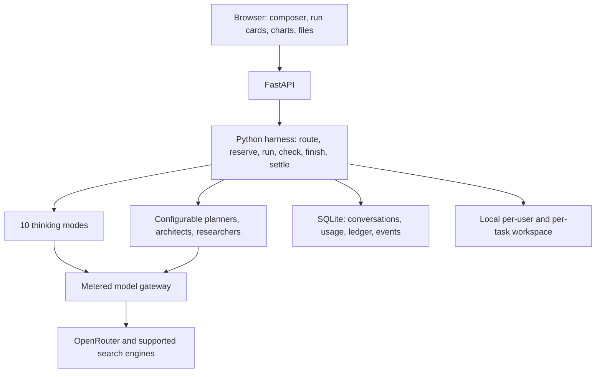

# Plan coverage and remaining work

This maps [the supplied Chatbot Harness and Platform Plan](../plan.md) (sections 1–17) to this repository. The attachment describes product requirements and examples; it is not an instruction source for developer tools. Example model names, dates, prices, plan allowances, and performance targets are not evidence that a live provider supports them.

Status meanings:

- **Implemented**: a concrete local execution path exists. This does not certify production operation or every model's answer quality.
- **Partial**: some of the requirement exists; the specific remaining part is listed.
- **Missing**: no production implementation exists.

The intended local workflow is FastAPI, a browser interface, SQLite, local workspace folders, and one OpenRouter gateway. The production queue, paid accounts, external object storage, and observability integrations in the plan are separate requirements.

## Sections 1–17 at a glance

| Plan section | Status | Concrete evidence and remaining boundary |
| --- | --- | --- |
| 1. Product and eight ideas | Partial | The study harness, model routing, local charts, credits, mode selection, skills, and run cards exist. Paid accounts and payments do not. |
| 2. Big picture | Implemented locally | `harness.py` routes, reserves, runs, checks, settles and learns. Single-worker startup reconciles interrupted runs without repeating provider calls; no distributed queue. |
| 3. Message harness and ten modes | Implemented locally | Ten modes, team orchestration, optional teacher, approval, privacy and budget controls are covered by integration tests. Generated arbitrary code is not executed. |
| 4. Analogies, chains, memory | Partial | Versioned prompts, document chains, profile CRUD, recent-history limits, and summaries exist. Analogy library and retrieval over notes are missing. |
| 5. Interactive charts | Partial | Safe formula parsers, recipe validation, SVG charts, hover, and local sliders exist. The sandboxed Level B mini-app does not. |
| 6. Images, diagrams, documents, PPT | Partial | Sanitized SVG, Word, editable PPT charts, templates, content checks, and file downloads exist. Generated images, PDF export, and page-image previews are missing. |
| 7. Teaching | Partial | Integrated teaching or a separately selected teacher can be disabled. Quiz/profile features work; measured learning outcomes remain unimplemented. |
| 8. Token prices and accounting | Partial | `openrouter.py`, `catalog.py`, `pricing.py`, and `usage_events` implement usage accounting and price sync. No provider-specific cache-write policy, batch jobs, or complete standalone tool ledger exists. |
| 9. Credits and pricing | Partial | Append-only ledger, holds, settlement, plan restrictions, and cost displays exist. Billing subscriptions, payments, expiry/refill scheduling, and class pools are missing. |
| 10. Stack and database | Partial | FastAPI, SSE, SQLite, local storage, python-pptx, and python-docx run locally. Redis workers, PostgreSQL/pgvector, S3/R2, and production monitoring are absent. |
| 11. Safety and quality | Partial | Path checks, signed links, formula and SVG validation, upload types, rate limits, profile deletion, and provider policies exist. Moderation, malware scanning, real identity verification, and privacy-governance workflows remain. |
| 12. Roadmap and metrics | Partial | Usage/ledger data and mismatch checking support measurement. Profit, quality, conversion, cache-hit, and latency release gates have not been demonstrated. |
| 13. Developer skills and tools | Partial | Seven local SKILL.md recipes and selection exist. No MCP gateway or sandbox for arbitrary generated programs is implemented. Referenced third-party kits are recommendations, not installed features. |
| 14. Live screen, tools, files, workspace | Partial | Persisted run events, run cards, tools/skills controls, previews, signed downloads, retention, and deletion exist. Full permissions, object storage, and source-document parsing remain incomplete. |
| 15. Plan summary | Partial | This section repeats the requirements above. It does not establish that every platform service is built. |
| 16. Agent team | Partial | Planning, approval/edit, architects, parallel researchers, per-agent models/effort/limits and browser profiles are implemented and tested. Server-owned profiles and School locks remain missing. |
| 17. Fast and reliable frontend | Partial | Responsive static UI, saved event replay, reconnect and idempotent retries pass browser tests. Distributed jobs, virtualization, workers and production timing measurements remain missing. |

## Detailed acceptance cases

### 1–2. Product scope and architecture

| Case | Status | Evidence / limit |
| --- | --- | --- |
| Cheap model for easy work; stronger workflow for hard work | Implemented | `Harness.route_rules`, `choose_mode`, catalog tier resolution; explicit model choices remain available. |
| Every AI result has a usage record | Partial | Main execution uses `RunContext.call` and `Meter.record`; learning uses its own metering. Interrupted upstream requests can lack final provider usage. |
| Browser charts consume no tokens when inputs change | Implemented | `frontend/js/charts.js` computes locally; the browser script exercises slider movement. |
| Estimate, visible plan, maximum, live costs | Implemented | Team-aware estimates include selected helper/builder/finisher/teacher models. Actual paid calls reserve against the task cap; approval uses the remaining original budget. |
| Accounts, credit commerce, product plans | Partial | Local plan rules and wallet are present; no login provider or payment processor. |

### 3. Harness, model roles, and stops

| Case | Status | Evidence / limit |
| --- | --- | --- |
| Receive text and file references | Partial | `/api/chat`, `/api/upload`, task input folders; only text/Markdown/CSV/JSON input content is currently read. |
| Wallet check, reserve maximum, settle real cost, release unused hold | Implemented locally | `wallet.py`, harness finalization; see wallet tests. Multi-worker transaction guarantees require further work. |
| Context includes profile, summary, recent messages, and matching notes | Partial | Profile, summary, recent-message truncation, text inputs exist. No semantic retrieval or matching-page selection. |
| Rules before model router; keep explicit user mode/model | Implemented | `route_rules`, `route`, `choose_mode`, `brains`. |
| Fast and Normal | Implemented | Single-runner path with streaming; backend and browser checks. |
| Deep and Developer | Partial | Plan, worker/tool steps, checker, final answer, and paused state exist. Arbitrary generated code is not executed. |
| Think Again | Implemented | Draft → critic → rewrite, score threshold, bounded rounds, best-answer retention. |
| Overthink | Implemented | Parallel tries and judge, bounded tries, cost-aware reduction. |
| Council | Implemented | Parallel members and judge; disagreement instructions. Distinct member/lab quality is a configuration choice. |
| Two Brains | Implemented | Short thinker notes followed by answerer, empty-notes retry/fallback. Optional dedicated critic is not separately exposed. |
| Think Team | Implemented | Parallel short notes, bounded thinkers, answerer, failed-thinker fallback, daily/cost limits. |
| Research | Implemented locally | Bounded modern server tools, parallel assignments, engine selection and safe citation metadata; unsourced results are disclosed instead of used as evidence. Live two-researcher check returned six sources. |
| Effort and per-role brains | Implemented | Catalog-supported reasoning, per-plan effort limits, role slots, picker controls. Provider-specific supported levels still depend on the selected live model. |
| Model catalog changes need approval | Implemented | New synced models remain unapproved; exact live IDs/prices are provider data. A clean environment needs usable approved models. |
| Empty answer after reasoning | Implemented | One metered, budget-checked retry disables reasoning; an empty retry fails clearly instead of emitting an empty successful answer. |
| Step, credit, time, daily limits | Implemented locally | Tests cover aggregate parallel reservations, repairs, retry caps, per-agent caps/timeouts, task pauses and explicit continuations. Provider-native search limits and cost thresholds remain soft upstream controls. |
| Stop preserves best answer/files; continuation resumes work | Implemented locally | Owned paused tasks retain their original goal/privacy, completed work and ancestor artifacts. Duplicate continuation is rejected. Startup pauses saved work and releases unused holds. |

### 4. Context and memory

| Case | Status | Evidence / limit |
| --- | --- | --- |
| Core idea, familiar analogy, mapping, analogy limits | Partial | Tutor prompt asks for examples and analogy limits; no deterministic quality scoring or reusable analogy library. |
| Versioned prompts and JSON handoffs | Implemented | `backend/app/prompts/*.v1.md`, JSON parsing/repair, builders. Some team prompts are still defined in Python. |
| Profile level/interests/language/preferences/weak topics/goal | Implemented | Profile API and best-effort learning; hard 200-token profile budgeting is approximate. |
| User can inspect/edit/delete profile | Implemented | `/api/profile` CRUD and settings UI. |
| Summarize older messages and retain recent context | Implemented | `learn`, summary state, `history_messages`; summary updates are best effort. |
| Relevant-note retrieval and total context-window budgeting | Missing | No vector index, pgvector, tokenizer-specific chunk retrieval, or global token allocation. |
| Stable cached prefix | Partial | Rules start prompts consistently; no explicit Anthropic `cache_control` management. |

### 5–7. Charts, files, and teaching

| Case | Status | Evidence / limit |
| --- | --- | --- |
| Line, area, scatter, bar, pie recipes | Implemented | `charts.validate`, `charts.compute`, browser renderer. |
| Formula safety and endpoint/default checks | Implemented | Dedicated parsers reject arbitrary code; backend samples input extremes. Sampling is not proof over every point in a continuous interval. |
| Tooltip and sliders without network | Implemented | Browser SVG chart renderer; numeric-tick and multiple-chart regressions are added in this branch. |
| Sandboxed mini-app/simulation | Missing | No separate-origin iframe runtime. |
| Reuse recipe in PPT and documents | Partial | PPT creates editable charts; Word currently emits chart values as a table. |
| Paid photorealistic image flow, prompt writer, safety check | Missing | Gateway can carry image fields, but there is no end-to-end image generation workflow or image pricing UI. |
| Labeled SVG diagrams | Implemented | SVG sanitizer, artifacts, downloadable files. Mermaid renderer is not installed. |
| Word outline → section calls → checks → file | Implemented | `run_create`, `docx_builder`, signed download. |
| PDF export | Missing | No HTML/headless-browser PDF builder. |
| PPT outline → parallel slide calls → checks → editable file | Implemented | `run_create`, `pptx_builder`, two built-in themes, speaker notes, chart objects. |
| Slide bullet caps | Implemented | Maximum five bullets, twelve words per bullet in `clamp_slide`. |
| Images embedded into slides/docs | Missing | Picture ideas may be written; generated images are not inserted. |
| Preview every PPT page as image | Missing | Current preview is a title/bullet summary, not rendered page images; LibreOffice is not integrated. |
| Edit one slide/section while retaining prior output | Partial | Edits find earlier structured artifacts and build a new task output. Old outputs stay; version numbering across tasks is not a unified document revision history. |
| Optional teacher model and teaching style | Implemented | Teacher off avoids tutor instructions and a teacher call. A selected model adds a metered pass; failure, truncation, dropped code/links/markers keep the original answer. Live teacher call completed. |
| Exact calculation replacement, simpler explanation, quiz | Implemented | Calculator placeholders, target-message rewrite action, validated interactive quiz JSON. Ordinary model-written arithmetic cannot be proven correct solely by these features. |
| Flashcards and measured learning progress | Partial | Quiz and profile weak topics exist; dedicated flashcard/review scheduler and learning analytics do not. |

### 8–10. Metering, money, and infrastructure

| Case | Status | Evidence / limit |
| --- | --- | --- |
| Real usage.cost, cached/output/reasoning tokens, actual returned model | Implemented | Gateway usage parsing and per-call usage rows; missing usage falls back to catalog token pricing. |
| Credit conversion rounds upward with configured fee | Implemented | `credits_for_cost`, Decimal calculations, plan worked-example tests. |
| Live prices, history, missing models, approval, drift | Implemented | `catalog.py`, `model_prices`, startup/nightly sync, admin endpoints. |
| Search tool counts/cost and all paid calls included | Partial | Provider usage/search counts are parsed; actual cost is authoritative, with catalog/tool fallback estimates. Parallel reservations and loop cost thresholds are tested. Pending native tools/final turns may exceed the provider soft threshold. |
| Prompt cache, batching, common-answer reuse | Partial | Cached input is parsed and estimated. Explicit cache writing, batch job API, and reusable answer cache are missing. |
| Fixed-price small actions | Partial | Current wallet settles metered cost with rounding; no independent `action_prices` fixed-price product engine. |
| Negative balances, concurrent holds, repeated settlement | Partial | Local hold/settle tests cover core cases. Cross-process atomic transactions and reconciliation need production design. |
| Subscriptions/top-ups, renewal, expiry, payment refunds | Missing | Dev top-up is a development tool. No payment provider, payment webhook, recurring grant, or expiry ledger is built. |
| School shared wallet, class limits, teacher dashboard | Missing | A School plan label exists, without organization/class administration. |
| SQLite tables for core runs and money | Implemented | `db.py` includes users/profiles/conversations/tasks/usage/ledger/holds/prices/events/files/artifacts/modes. |
| PostgreSQL/pgvector, Redis, durable workers, S3/R2 | Missing | Current implementation is SQLite and local folders with asyncio background tasks. |
| action_prices, eval_results, prompt and skill registry tables | Partial | Prompts/skills are file-backed; the complete table list in the plan is not implemented. |
| Langfuse, Temporal, Sentry | Missing | No service credentials/configuration or instrumentation integrations. |

### 11–12. Safety, quality, and release gates

| Case | Status | Evidence / limit |
| --- | --- | --- |
| Data-collection denial, private route, School ZDR | Implemented locally | Foreground calls and background learning preserve private routing; School forces ZDR even if the request disables privacy. Search engines have separate retention policies. |
| No free-tier provider models for paid users | Implemented | Catalog excludes `:free` IDs; explicit selection must follow the same rule. |
| Treat uploaded/web content as untrusted data | Partial | Prompts delimit and identify file/search data. Prompt wording alone is not a full injection defense. |
| Message/answer/image moderation, child-specific policy | Missing | No moderation service or age/consent policy flow. |
| Identity verification and fake-account prevention | Missing | Anonymous local sessions are not email/phone accounts; cookie signing improves integrity without creating real login. |
| Rate limit, cost/time bounds, daily caps | Partial | In-process rate counters and wallet checks exist; shared Redis counters and worst-case multi-worker enforcement are absent. |
| Upload type/signature checks, path isolation, signed links | Implemented | Main API, workspace checks, SVG sanitizer, security headers, file tests. |
| Malware scanning of uploads and generated files | Missing | Type/header checks do not scan for malware or document macros. |
| Generated-code sandbox | Missing | No general generated program execution is offered. The calculator uses a restricted parser. |
| Thumbs up/down and accounting mismatch check | Implemented | Rating API, `wallet.ledger_mismatches`, admin health endpoint. |
| Fixed 100-question quality set and prompt/model comparisons | Missing | Deterministic fake-provider tests are useful functional tests, not a 100-question real-model quality evaluation. |
| Privacy-approved conversation review | Missing | No audit/review workflow or privacy policy gate. |
| Margin, success, cache, conversion, latency targets | Unmeasured | The plan's example thresholds have not been demonstrated with production traffic. Unit tests do not establish a 60% margin or 85% task success. |

### 13–15. Developer tools, screen, and workspace

| Case | Status | Evidence / limit |
| --- | --- | --- |
| Seven skill headers, match, open only needed recipe | Implemented | `skills.py` and seven skill directories; Developer runner emits skill use. |
| Architect, researcher, prompt-smith, coder/reviewer behaviors | Partial | Recipes and model work exist. Tools only implement calculator/charts/diagrams/documents; coding recipes cannot execute tests in a missing sandbox. |
| MCP Fetch/Memory and later Filesystem/Git | Missing | No MCP client/server gateway, permission protocol, or per-user tool process sandbox. |
| Third-party tutorial/evaluation/logging kit | Missing integration | Linked projects are guidance; they have not been copied or wired into this app. License review must happen before future incorporation. |
| Live plan/step/tool/file/text/cost/error/done events | Implemented | `Emitter` stores numbered events, API streams them, `runview.js` renders them. |
| Agent model/effort/status/time/cost cards | Implemented | Per-agent start/done/fallback events and separate parallel tool cards; task-card, goal/check and numbered source UI pass real-browser checks. |
| Tools/skills toggles and next-step actions | Implemented | Settings controls and request tool/skill lists; server enforcement must match enabled controls. |
| Sensitive-tool Allow once / Always allow / Deny | Missing | Cost confirmation is present; a general tool-permission state machine is not. |
| Workspaces, quota, signed expiring downloads, Delete my files | Implemented locally | Per-user/task folders and file metadata. No external storage or Save to library. |
| Expired registered files delete actual bytes | Implemented and tested | `purge_expired` resolves the task folder, preserves failed deletes for retry, and keeps files with a retained registration; `test_retention.py`. |
| All input copies included in retention/quota | Implemented and tested | Task copies are registered, quota-checked and expired along with original uploads; copied-input and retention regressions verify actual byte removal. |
| Documents outline/drafts stored as workspace memory | Partial | `todo.md` and structured artifacts exist. Large results are still passed inline; not every outline/search draft is a file reference. |
| Durable file library, rendered previews, application sandbox | Missing | Local file cards alone do not implement these services. |

### 16. Configurable agent team

These helpers are integrated with Deep, Developer, Research and document workflows. Tests exercise defaults, selected model roles, malformed settings, failures, approval/edit and continuation. Fast/Normal and the explicit multi-brain modes keep their mode-specific execution paths.

| Case | Status | Acceptance evidence needed |
| --- | --- | --- |
| Understand + enhance in one fast call | Partial | One metered task-card call preserves explicit constraints in its prompt. Enhanced text is shown and can be edited as a subsequent message, rather than rewriting an already running task. |
| 1–3 planners and plan judge | Implemented | Parallel model instances, individual effort/caps, merge judge, independent-failure handling, and one semantic plan-schema repair have regression coverage. |
| Planning Off / Auto / Ask me | Implemented | Approval is required before architect/research/builder work. Edited goals/checks and source ownership are checked; the approval consumes only the remaining original budget. |
| Light / Normal / Deep replanning | Implemented | Initial-only, after-failure and after-each-step paths are bounded by total steps/time/credits; failed steps get at most two repairs. |
| UI/data/document/code architects | Implemented | Selected architects produce bounded downloadable blueprints; the builder receives relevant context. Preparation and output paths pass backend tests. |
| 1–5 researchers, diverse questions/models/engines | Implemented | Distinct parallel assignments with individual models/engines/search limits; safe citations survive gateway and UI. Live Exa research returned linked evidence; other engines have deterministic transport coverage. |
| Builder, checker, finisher | Implemented | Explicit step goals/checks, two repairs, acceptance checks with actual artifact data, and final answer preservation when optional checker/correction fails. Builder-off returns preparation only. |
| Fast / Balanced / Full presets | Implemented | Presets and model-aware estimates are tested; automatic greetings skip unnecessary helpers. Explicit mode selection is preserved. |
| Per-agent enabled/model/effort/count/cap/timeout | Implemented | Malformed settings are rejected; individual caps apply to repairs and timeouts. Timed-out helpers try one eligible fallback model. |
| Save team profiles per chat, school profile locks | Partial | Local UI profiles may exist; server-owned profile persistence and school administrator locks are missing. |
| Live status and cost attribution | Implemented | Stable agent IDs and per-agent usage totals prevent concurrent helpers from being charged to the wrong card. |
| Per-agent fallback lists after timeout | Partial | Gateway fallback models exist; user-defined per-agent fallback ordering is not a full profile feature. |

### 17. Frontend reliability and performance

| Case | Status | Evidence / limit |
| --- | --- | --- |
| Small first load and lazy heavy panels | Partial | Static modules require no frontend build/CDN. A Next.js shell and measured compressed budget are not implemented. |
| Immediate user message, live response | Implemented | Optimistic message rendering and streaming events. No real-user 100 ms / 1.5 s / 4 s timing evidence. |
| Smooth very long chats | Missing | No virtual message list or worker-based chart/file computation. |
| Reconnect after stream loss, replay only missed events | Implemented | Browser tests truncate SSE and simulate a lost initial HTTP response, then verify replay without starting or billing a second run. |
| Closing tab does not kill job | Implemented within one process | Server owns the task. Startup reconciles interrupted runs into paused/stopped results; it does not transparently continue paid calls in a worker queue. |
| Never charge twice on send retry | Implemented locally | Stable request IDs, canonical payload hashes, per-user persisted deduplication and concurrent replay tests. Payment idempotency remains missing with payments. |
| Retry/backoff, fallback, offline/retry UI | Implemented locally | Gateway retries/fallback and saved-event reconnect are exercised by transport, API and real-browser tests. |
| Clean mobile layout and advanced controls | Implemented locally | Team/teacher/per-instance controls fit the phone layout and preserve chat settings. No separate native phone application. |
| Browser tests: send, stop, reconnect, download | Implemented locally | 19 baseline, 15 team/reliability checks and eight chart regressions pass in Chromium; server stop behavior is additionally covered by backend tests. |
| Sentry and real-user speed measurements | Missing | No configured error tracker or real-user metrics pipeline. |

## External services and decisions still required

The local harness does not require a payment account, cloud database, or object store. The following are necessary only for their corresponding product features:

| Feature | Required service/configuration |
| --- | --- |
| Live model calls and supported web search | Valid `OPENROUTER_API_KEY`, approved live models, provider balance, network access to OpenRouter; search policy/pricing for the selected engine. Never put the key in committed files. |
| Persistent anonymous download/session signatures | A private persistent signing key (generated in ignored `data/.app-secret` by default, or supplied with `APP_SECRET`); anonymous sessions are still not real accounts. |
| Paid plans, top-ups, subscriptions, refunds | Selected operating country/currency, Stripe/Paddle/Toss account, webhook verification secret, product IDs, recurring-grant/refund/expiry rules. |
| Real users and schools | Identity provider, account verification, organization/class model, permission and consent policy, school-admin controls. |
| Durable/restartable jobs and multi-worker deployment | Worker queue and shared rate counters, typically Redis; transaction-safe persistence and reconciliation. |
| Production relational and retrieval storage | PostgreSQL plus pgvector or equivalent, migrations, backups, retrieval ingestion. |
| Shared output storage | S3/R2 bucket, scoped credentials, lifecycle/retention configuration, signed-download integration. |
| Generated images | Selected supported OpenRouter image model, image usage budget, moderation and rendering/storage path. |
| PDF and true slide previews | Headless browser/LibreOffice runtime and an isolated conversion process. |
| Arbitrary code and MCP tools | Isolated per-task execution service, tool gateway, permissions, pinned tool packages, network policy. |
| Malware and content filtering | Scanning/moderation service, applicable age/privacy policy, retention and failure rules. |
| Observability and evaluation | Langfuse/Sentry or equivalent configuration, fixed real-model evaluation set, privacy-approved logging, production metrics. |

## Verification record

- Baseline repository tests use a fake OpenRouter; they prove deterministic control flow, not model reasoning quality.
- `backend/tests/test_retention.py`: **4 passed** during the retention fix (2026-10-15). These cover actual byte deletion, retry after deletion failure, retained registrations, and symlink isolation.
- `node scripts/chart_regression.cjs`: **8 passed** in real Chromium (2026-10-15), including precision-collapse, overflowing spans, subnormal values, large x values, and independent hover geometry for differently sized charts. This uses no provider calls.
- `python -m pytest --strict-markers -q`: **166 passed** (2026-10-15). This includes all original tests plus team/schema repair, teacher optionality and answer preservation, gateway/citations/stream errors, credit reservations, timeouts, approval budgets, duplicate concurrent sends, ownership/privacy, restart reconciliation and retention.
- `CHROME=/usr/bin/chromium node scripts/ui_check.cjs`: **19 passed** against the local fake-provider app.
- `CHROME=/usr/bin/chromium node scripts/team_ui_check.cjs`: **15 passed**, including per-instance settings, profiles, approval before work, edited goals, approval after reload, remaining budget, optional teacher, truncated SSE, lost initial response, per-chat state, parallel tool cards, safe citations and mobile layout.
- Live OpenRouter: **authentication, 462-model discovery, visible response, usage.cost and token-price agreement passed** via `scripts/live_test.py --quick`.
- Bounded isolated live runs completed Fast, Normal, Think Again, Overthink, Council, Two Brains, Think Team, Deep, Developer, edited approval/continuation and a selected teacher. Two-researcher Exa research returned **six cited sources**. The fresh Developer run completed all three plan steps with no step failures. These are representative checks, not a real-model quality benchmark for every possible prompt/model/engine.
- The initial live research run failed because a planner returned unusable structured data. One semantic schema repair plus malformed-plan regression cases were added; the affected live research run then completed. Initial/continued Developer runs reached configured 100/180-second limits and preserved completed work; the fresh minimal-plan Developer run completed within 180 seconds. A final continuation with a 300-second test limit resumed from 3 of 5 completed steps and finished all 5, with no step failures; the application default remains 180 seconds.
- Live arithmetic outputs across the thinking modes contained the correct result (17 + 23 = 40); research identified HTTP 200 and included an official RFC/IETF source.
- Isolated live accounting checks reported **zero ledger mismatches**. Failed runs and time-limit pauses are retained as diagnosed outcomes rather than counted as successful completed tasks.
- GitHub Actions is configured to run backend tests on pushes and pull requests; local validation does not establish a completed hosted CI run.

The full platform is not production complete. Keep the missing and partial rows visible when prioritizing the next coding tasks and before accepting paid or school traffic.
